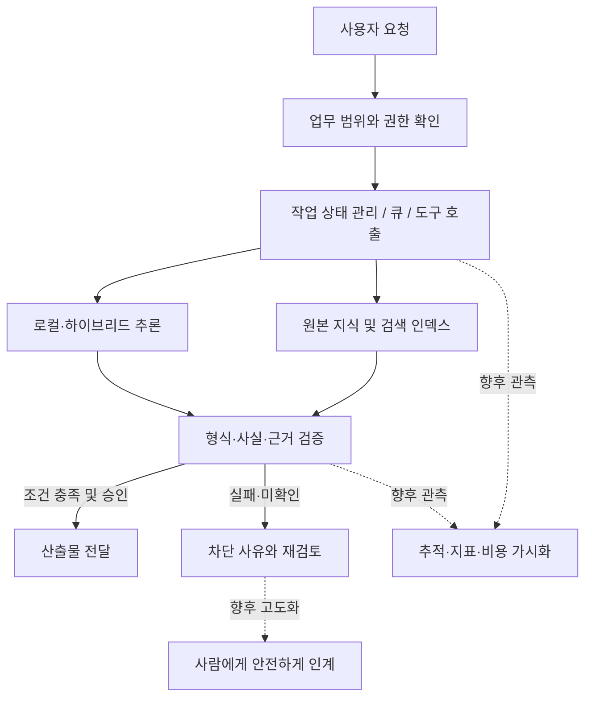

# HARNESS-AI — Engineering Principles & Development Roadmap

개인 프로젝트에서 정리한 설계 판단과 앞으로 검증할 과제  
2026년 10월 12일

이 글은 HARNESS-AI가 이미 완성되었거나, 특정한 성능과 보안 수준을 확보했다는 기술 인증 문서가 아닙니다. 무엇을 만들고 싶어서 프로젝트를 시작했는지, 개발 과정에서 어떤 문제가 보였는지, 다음에는 어떤 근거를 확보해야 하는지를 정리한 설계 기록입니다. 구현과 테스트의 상세한 범위는 [Engineering Recovery](ENGINEERING_RECOVERY.md), [Evidence & Limitations](EVIDENCE_AND_LIMITATIONS.md)에 따로 적어 두었습니다.

AI 관련 수학과 소프트웨어를 집중적으로 학습하며 개인 프로젝트를 진행한 기간은 아직 약 두 달입니다. 따라서 여기의 판단에는 실제로 시험해 본 부분과, 앞으로 확인해야 할 가정이 섞여 있습니다. 그 차이를 드러내는 것이 이 문서의 출발점입니다.

## 왜 자동화를 만들고 싶은가

AI를 직접 사용하면서 상담, 학습, 문서 작업에 드는 시간이 줄어드는 경험을 했습니다. 동시에 AI가 그럴듯하지만 틀린 내용을 제시하거나, 주어진 업무 범위를 넘어서 도구를 선택하는 경우도 보았습니다. 기능이 늘어나는 속도에 비해 사람이 결과를 이해하고 통제하는 방법은 아직 더 개선될 여지가 있다고 느꼈습니다.

그래서 관심을 갖게 된 것이 AI 자체의 성능뿐 아니라 이를 실제 업무에 연결하는 소프트웨어입니다. 누구나 복잡한 개발 환경을 배울 필요 없이 도움을 받을 수 있되, 자신이 맡긴 일의 범위와 사용된 데이터, 실패한 이유를 확인할 수 있어야 한다고 생각합니다.

사용자에게는 간결한 화면과 쉽게 복구할 수 있는 작업 흐름을 제공하고, 개발자에게는 문제를 재현할 수 있는 기록을 제공하며, 운영자에게는 장애와 비용을 판단할 수 있는 지표를 제공하는 것을 장기적인 목표로 삼고 있습니다. 그런 경험을 실제 사용자에게서 검증한 단계는 아닙니다.

## 원본, 판단, 실행을 구분하는 구조

HARNESS-AI에서 시도한 접근은 모델이 모든 것을 결정하게 하는 대신, 작업을 작게 나누고 단계 사이에 확인 가능한 계약을 두는 것입니다. 아래는 일부 구현과 고도화 계획을 함께 표현한 개념도입니다. 실선이라고 해도 각 단계의 운영환경 전체 E2E 성공을 뜻하지는 않습니다.

원본 지식(IP Fabric)과 검색을 위한 파생 인덱스를 분리하려는 이유는 검색 속도와 원본 보전이 서로 다른 문제이기 때문입니다. `ip_fabric/core.py`에는 버전별 내용과 SHA-256을 이용한 무결성 점검이 있습니다. 이는 저장된 내용의 변경 여부를 탐지하는 수단이지, 그 내용의 사실성이나 작성자를 증명하는 장치는 아닙니다.

`knowledge_ir_v1/retrieval.py`는 근거의 식별자, 검토 상태, 참조 파일을 확인하는 경로를 포함합니다. 유사한 문장을 검색에서 찾았다고 해서 그 문장이 곧바로 사용할 수 있는 사실이 되는 것은 아니므로, 검색과 검증을 분리하고자 했습니다. `hybrid_ai/provider.py`의 로컬 모델 연결부와 `control_plane/orchestrator.py`의 상태·작업 처리도 이러한 책임 구분을 위한 모듈입니다. 해당 파일이 존재한다는 사실만으로 전체 연동 성숙도를 주장하지는 않습니다.

## 검증 결과보다 검증의 범위를 먼저 확인하기

현재 가장 중요한 미완료 항목은 교육용 문서 생성의 최종 E2E입니다. 2026년 10월 11일 공개 기록에는 Python 테스트 78건 통과·1건 생략, TypeScript 빌드와 4건 테스트 통과, 로컬 Nomic 임베딩과 검색, 격리된 Redis/RQ 작업 실행 결과가 있습니다. 하지만 Academy 흐름은 실제 검색과 생성 이후 과학적 내용 검증에서 차단되어, 최종 PDF 생성과 사람 승인까지 완료되지 않았습니다. 실패를 성공으로 표시하지 않는 것이 이 프로젝트의 기본 원칙입니다.

합성 회귀시험의 480건은 12개 유형을 반복한 상호 연관된 사례입니다. 실무 문서 480개에서 일반화 성능을 측정한 결과로 해석하지 않습니다. 마스킹 역시 합성 문서에 대한 제한된 검사일 뿐 실제 개인정보 전반의 탐지율을 뜻하지 않습니다.

2026년 10월 12일에 실행한 별도의 평가 스크립트(v10) 출력에서는 Hypothesis, Inspect AI, promptfoo의 격리 설치와 지정된 평가 하네스 단계가 성공으로 기록되었습니다. Prometheus 지표 내보내기 단계도 실행되었습니다. 다만 이는 도구를 연결하고 오프라인 기록·속성 테스트 등을 실행한 결과이지, 새로운 독립 데이터셋으로 AI 출력 품질이나 보안 효과를 입증한 결과는 아닙니다. 해당 상세 로그는 아직 이 공개 저장소의 검증 자료에 편입하지 않았습니다.

앞으로 평가를 다음처럼 나누어 관리하려 합니다.

| 평가 대상 | 검토 도구와 방법 | 아직 확보해야 할 근거 |
|---|---|---|
| 코드 불변식·예외 조건 | Hypothesis — 속성 기반 테스트와 실패 사례 축소 | 실제 코드 경계별 속성, 재현 가능한 실패·수정 기록 |
| 프롬프트·RAG 출력 | promptfoo — assertion 및 동일 과업 비교 | 독립적으로 구성한 사례, 근거·형식·거부 판단 기준 |
| 모델·에이전트 수행 | Inspect AI — Dataset·Solver·Scorer | 도구 호출 추적과 과업별 채점 타당성 |
| 업무 흐름 전체 | E2E 및 별도 사람 검토 | 승인 가능한 산출물, 재실행, 실패 복구 |
| 운영 상태 | Prometheus 등 지표 및 추적 | 지연·오류·비용·정보보호 영향의 실제 관측 |

도구의 이름보다 데이터셋과 채점 기준, 버전, 실행 환경, 판단의 재현성이 더 중요하다고 생각합니다. 적용할 패키지의 라이선스와 전이 의존성도 버전별로 확인하려 합니다.

## 이용자의 데이터와 권한을 다루는 방법

개인화된 AI가 실용적이려면 사용자의 맥락을 어느 정도 알아야 합니다. 하지만 더 많은 데이터를 모으는 것이 항상 좋은 것은 아닙니다. 공개 지식, 개인 설정, 민감한 개인·조직 자료, 실제 시스템을 변경할 권한을 서로 다른 계층으로 취급하려 합니다. 처리 목적, 열람 주체, 보존 기간, 수정·삭제·철회 방법을 사용자가 이해할 수 있어야 합니다.

SHA-256 같은 해시는 무결성 확인에, 암호화는 기밀성 등 특정 보호 목표에, 인증·인가는 접근 주체와 권한 판단에 사용됩니다. 어느 한 방법도 공격 가능성을 없애지는 못합니다. 로컬 추론은 외부로 보내는 정보를 줄일 수 있지만 플러그인, 원격 연결, 운영자 실수 같은 다른 경로까지 자동으로 제거하지는 않습니다. 이용자 동의와 면책 문구 역시 법적 의무나 타인의 권리를 대신할 수 없습니다.

보안 설계는 ‘절대 안전’의 선언보다 가능한 실패 조건을 적고, 그 조건을 정해진 격리 환경에서 검증하고, 사고가 나더라도 피해와 권한을 제한하는 과정이라고 보고 있습니다. 장기적으로는 승인된 테스트 환경의 사본에서 자동 보안 평가를 실시하는 구조도 검토하고 싶습니다. 지금은 위협 모델과 격리·감사·중단 조건을 먼저 갖추어야 하는 구상 단계입니다.

## 유지보수, 원격 사용, 장애 대응

개인 장비에서 여러 모델과 Python·Node·컨테이너를 조합해 보니 의존성 충돌과 환경 차이가 개발 시간을 많이 소모했습니다. 유지보수를 쉽게 만들려면 기능을 추가하기 전에 버전과 인터페이스를 명시하고, 테스트와 로그만으로 문제를 되짚을 수 있어야 한다고 느꼈습니다. 모델 제공자를 바꿀 때도 호출 형식과 결과 검증 규칙은 분리할 필요가 있습니다. 실제 교체 가능성은 같은 과업을 두 백엔드에서 수행하는 시험으로 확인해야 합니다.

Tailscale, RDP, Sunshine·Moonlight 등으로 개인 워크스테이션을 원격 활용한 경험은 ‘성능이 필요한 연산’과 ‘사용자가 접근하는 화면’을 분리하는 발상을 이해하는 데 도움이 됐습니다. 물론 개인 장비에서 유용하게 동작했다는 사실이 조직 환경의 보안이나 안정성을 보증하지는 않습니다.

운영 관점에서는 장애 시 원인과 영향 범위를 보여주는 화면, 안전한 재시도와 롤백, AI가 사용할 수 없을 때 사람이 이어받는 수동 절차를 구상하고 있습니다. 수동 전환이 새로운 무제한 권한을 뜻해서는 안 되므로 승인 이력과 작업 상태를 보존하는 방식이 필요합니다.

현재 개인 규모에서는 Docker Compose의 비용과 복잡도가 적절합니다. Kubernetes는 다중 노드, 배포 자동화, 롤링 업데이트, 복구와 확장이 필요한 단계에서 비교할 대상으로 두고 있습니다. 클러스터 운영 인력, 네트워크·스토리지, 접근통제, 모니터링과 관리비가 도입 이익보다 클 수도 있으므로 처음부터 적용하는 것이 반드시 더 좋은 선택은 아니라고 생각합니다.

## 연산자원과 사회적 비용을 함께 보는 이유

AI 서비스의 효용은 모델 점수만으로 설명하기 어렵습니다. CPU·GPU·NPU·메모리·스토리지·네트워크가 함께 동작하고, 큰 시스템에서는 데이터센터 건설과 전력·냉각·설비 교체·운영 인력이 필요합니다. 로봇으로 확장하면 센서, 구동기, 실시간 제어, 장애 시 안전성 같은 조건도 중요해집니다. 사용자가 얻는 편익 외에 누가 비용을 부담하는지까지 보아야 한다고 생각합니다.

예를 들어 완료된 업무 한 건에 드는 비용을 비교할 때에는 일정 기간에 배분한 설비비와 운영비를, 단순 요청 수가 아니라 실제로 검증되어 완료된 업무 수에 대응시켜 볼 수 있습니다. 이것은 앞으로 사용할 분석 관점이지 실제 프로젝트에서 산출한 절감 수치가 아닙니다.

개인 기기에서 처리할 일과 조직 내부에서 처리할 일, 공유 인프라에 맡길 일을 나누면 편의성·지연시간·보안·비용 사이의 다른 선택지를 만들 수 있을 것입니다. 전문가는 복잡한 기반 시설을 책임지고, 일반 사용자는 저렴하고 이해하기 쉬운 방식으로 AI 서비스를 이용하는 구조가 바람직하다고 생각합니다.

공공 AI 인프라가 접근성을 높이고 국내에서 축적한 운영 경험을 해외에 제공할 가능성에도 관심이 있습니다. 다만 국가 재정의 기회비용, 누구에게 어떤 순서로 접근권을 줄지에 관한 형평성, 민간과의 역할 분담, 정보 주권과 국경 간 규제, 환경 영향 등을 실증적으로 검토해야 합니다. 구체적인 정책이나 사업성이 입증됐다는 뜻은 아닙니다. 세계 어디에서든 개인의 데이터 통제권을 지키면서 일상과 일을 돕는 AI를 사용할 수 있으면 좋겠다는 것이 장기적인 방향입니다.

## 다음에 직접 확인할 일

우선순위는 지금의 가장 큰 미완료 항목부터 정했습니다.

1. Academy E2E의 과학적 내용 검증 실패를 재현하고, 독립적인 근거와 사람 승인까지 포함한 실제 산출물 흐름을 점검합니다.
2. Hypothesis·promptfoo·Inspect AI를 독립 테스트셋과 연결해, 단순 설치 확인이 아닌 품질·실패 분석으로 확장합니다.
3. 작업 추적·개인정보 처리·권한 경계를 평가하고, 사고나 AI 장애 시 안전한 인계·복구 절차를 시험합니다.
4. 같은 업무의 모델 백엔드 교체와 컨테이너 배포 정합성을 확인한 뒤, 필요가 입증될 때 Kubernetes의 비용과 이익을 비교합니다.
5. 더 긴 관점에서 엣지·조직 서버·공유 데이터센터·로봇 사이의 연산 배치가 사용자 경험과 사회적 비용에 미치는 영향을 공부합니다.

여전히 모르는 영역이 많고 실제 기관 시스템을 운영해 본 경험은 부족합니다. 그래서 ‘무엇이 가능하다’고 선언하기보다, 왜 필요한지 설명하고 작은 시험으로 확인하며 다음 결정을 수정하는 방식으로 배우고자 합니다.

---

자료와 작성에 관하여

- 기술 구현·시험에 관한 기록: [HARNESS-AI Engineering Work](HARNESS_AI.md), [Engineering Recovery](ENGINEERING_RECOVERY.md), [Evidence & Limitations](EVIDENCE_AND_LIMITATIONS.md), [Security & Scope](SECURITY_AND_SCOPE.md).
- 기술·사회적 구상과 프로젝트 경험: 작성자가 제공한 설명 및 프로젝트 진행 중의 판단을 바탕으로 서술했습니다.
- AI의 역할: ChatGPT가 문장·구성 정리, 기술 용어 점검 및 초안 편집을 도왔습니다. 프로젝트 코드 작성에도 AI 도구의 도움을 활용했으나, 이 문서가 코드의 전체 기여도를 정량적으로 산정한 것은 아닙니다.
- 기술 참고: [Hypothesis](https://github.com/HypothesisWorks/hypothesis), [promptfoo](https://github.com/promptfoo/promptfoo), [Inspect AI](https://github.com/UKGovernmentBEIS/inspect_ai), [Kubernetes](https://github.com/kubernetes/kubernetes). 재배포나 업무 도입 시 실제 사용 버전의 라이선스·전이 의존성을 별도로 확인해야 합니다.
